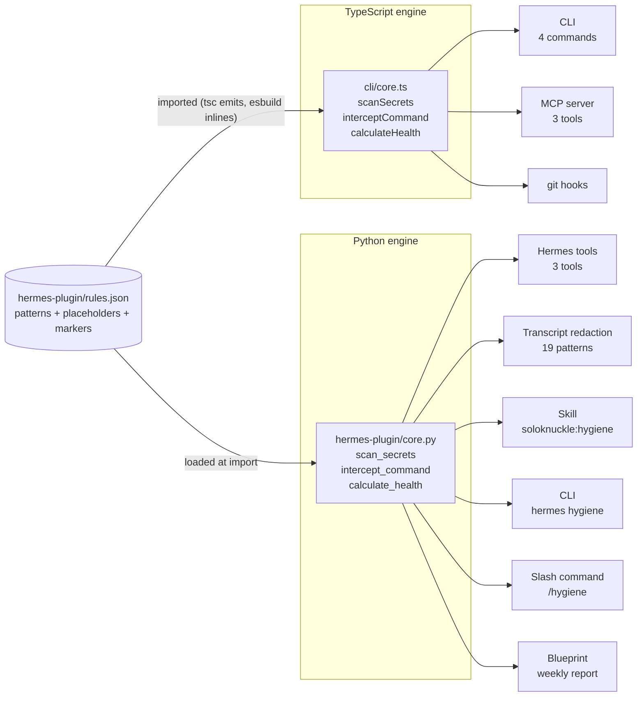
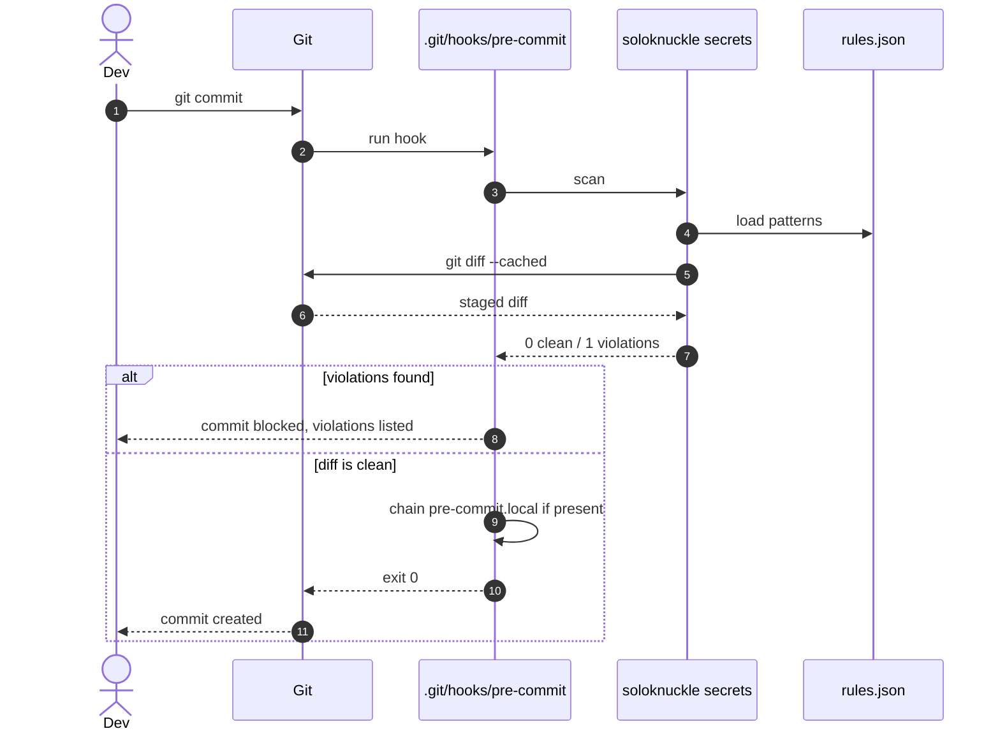
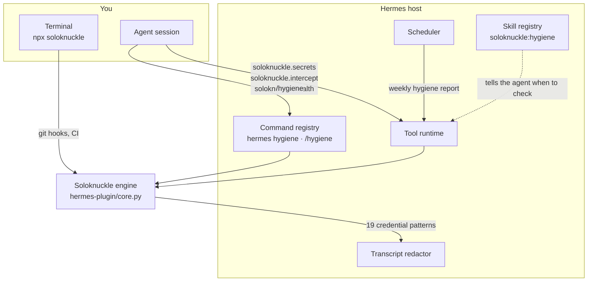

# Soloknuckle

Production hygiene for solo developers, in three checks that run on your machine
and nowhere else:

- **Secrets** — did a credential just enter the diff?
- **Firewall** — is this shell command about to destroy something?
- **Health** — is the project actually green before you push it?

It answers the same way from a terminal, a git hook, an MCP client, and Hermes
Agent, because all of them call one engine over one rule file.

No telemetry, no analytics, no network calls. The whole tool is deterministic:
same input, same output, every time.

## Install

```bash
npx soloknuckle init       # try it without installing
npm install -g soloknuckle # install once
```

Or the shell installer (needs Node 20+):

```bash
curl -fsSL https://raw.githubusercontent.com/z99wE/soloknucklefXrhermes/main/install.sh | bash
```

## Quick start

```bash
cd your-project
soloknuckle init      # scaffold AGENTS.md and safe git hooks
soloknuckle check     # score the project
git commit            # the hooks scan the staged diff and commit message
```

`init` installs `pre-commit` (secret scan), `commit-msg` (Conventional Commits),
and `pre-push` (health check), and never overwrites a hook you already have: it
moves the existing hook to `<hook>.local` and chains it. Running `init` twice is
a no-op.

## The three checks

### Secrets

Scans the staged diff (or one you pass in) for credentials that are about to
become permanent.

```bash
soloknuckle secrets
```

```
2 violation(s) found:
  -> Line 12: Stripe live key detected.
  -> Line 40: Private key detected.
```

Covered: Stripe, OpenAI, Anthropic, AWS, GitHub, GitLab, Slack, SendGrid, GCP,
npm, Hugging Face, Shopify, database URIs with inline passwords, and private
keys. The patterns live in [`hermes-plugin/rules.json`](hermes-plugin/rules.json).

Two escapes are built in and both are greppable:

- a token that is itself a placeholder (`xxxx`, `your_key_here`, `mock`, …) is
  ignored;
- any line containing `soloknuckle:allow` is ignored. Use it for fixtures, and
  expect to explain it in review.

### Firewall

Evaluates a command before you run it. Two tiers: **blocked** (exit 1) for the
unrecoverable, **caution** (exit 0) for the merely regrettable.

```bash
soloknuckle intercept rm -rf /
# Blocked: Recursive delete of a filesystem root or home directory

soloknuckle intercept rm -rf ./build
# Caution: Recursive force delete
#   Suggestion: Use 'rm -i' or 'trash-put' instead

soloknuckle intercept ls -la
# Allowed
```

Blocked: root and home deletion (including `sudo`, `--no-preserve-root`, `/*`,
`$HOME`), remote scripts piped into a shell (`curl … | sh`, `bash <(curl …)`),
raw disk writes, filesystem formats, SQL `DROP`.

Caution: `rm -rf`, `git push --force`, `chmod 777`, `git reset --hard`,
`git commit --amend`.

### Health

One score, four checks, and a non-zero exit when it is too low — so it can gate
CI.

```bash
soloknuckle check --min-score 80
```

```
  Score: 75/100  B

  Issues:
    -> Tests: failing
    -> Secrets: 2 violation(s)
```

| Check | Passes when |
|---|---|
| Dependencies | a `package.json` exists |
| Lint | `npm run lint` exits 0 |
| Tests | `npm test` exits 0 |
| Secrets | the current diff is clean |

`npm` is only invoked when the project has its own `package.json`; otherwise it
walks up the tree and lints somebody else's repository. A project without one
scores 25 and says so.

Grades: A ≥ 90, B ≥ 70, C ≥ 40, F below that.

## Commands

| Command | What it does | Exit codes |
|---|---|---|
| `soloknuckle init` | Scaffold `AGENTS.md` and git hooks (`pre-commit`, `commit-msg`, `pre-push`) | 0 |
| `soloknuckle check [--min-score N]` | Health score (default gate: 70) | 0 pass, 1 below gate, 2 bad flag |
| `soloknuckle secrets [diff]` | Scan a diff for credentials | 0 clean, 1 violations |
| `soloknuckle intercept <cmd...>` | Evaluate a shell command | 0 allowed/caution, 1 blocked |

## Architecture

One rule file, two implementations, every surface on top. The TypeScript engine
serves the CLI, the git hooks, and the MCP server; the Python engine serves the
Hermes plugin, which must stay self-contained (Hermes cannot shell out to `npx`
to answer a tool call). Both read `hermes-plugin/rules.json`, and
`test/parity.test.ts` fails the build if they ever disagree.



### What happens on `git commit`



## Hermes Agent integration

Soloknuckle is a native Hermes plugin, and it is optional on both sides: remove
it and Hermes keeps working; skip Hermes and the CLI keeps working. Every surface
is declared in [`hermes-plugin/plugin.yaml`](hermes-plugin/plugin.yaml) and
visible in `hermes plugins capabilities`. The agent sees three tools and five
host surfaces: redaction, a skill, a CLI command, a slash command, and a
blueprint. Nothing runs unless the user or the agent asks for it.



| Surface | Type | What it gives you |
|---|---|---|
| `soloknuckle.secrets` | tool | Scan a diff for credentials |
| `soloknuckle.intercept` | tool | Evaluate a command before it runs |
| `soloknuckle.health` | tool | Score the current project |
| Redaction patterns | additive | Credentials never reach the transcript |
| `soloknuckle:hygiene` | skill | Teaches the agent when to check |
| `hermes hygiene` | CLI | `check`, `secrets`, `intercept <cmd>` |
| `/hygiene` | slash command | Same checks, mid-session |
| Weekly hygiene report | blueprint | A scheduled check nobody has to remember |

The design rule for every one of them: **no hooks, no middleware, nothing that
rewrites model input or injects context.** `provides_hooks: []` and
`provides_middleware: []` in the manifest are the machine-checkable form of that
promise. See [HERMES-INTEGRATION.md](HERMES-INTEGRATION.md) for the full surface
map, the per-surface safety argument, and what is deliberately left out.

### Setup

```bash
hermes plugins install soloknuckle    # or: hermes plugins validate ./hermes-plugin
hermes plugins enable soloknuckle
hermes hygiene --help
```

### MCP

Any MCP client can use the same three tools:

```json
{
  "mcpServers": {
    "soloknuckle": { "command": "npx", "args": ["-y", "soloknuckle-mcp"] }
  }
}
```

See [MCP-INTEGRATION.md](MCP-INTEGRATION.md).

## Extending the rules

Every pattern is data, not code:

```json
{
  "label": "Stripe live key",
  "pattern": "sk_live_[0-9a-zA-Z]{24}",
  "redact": true
}
```

Edit `hermes-plugin/rules.json`, run `npm test`, and the change reaches the CLI,
the MCP server, the hooks, the redactor, and the slash command together. The
parity test runs a shared corpus through both engines and fails on the first
disagreement, so a rule cannot mean two different things.

## What this tool will never do

- Upload your code, diff, or command text anywhere.
- Run in the background, watch files, or phone home.
- Modify your shell config, your hooks, or your repository without telling you.
- Delete anything outside its own directories (`scripts/uninstall.sh`).
- Ask for an API key. There is no service to authenticate to.

## Development

```bash
npm install
npm run typecheck     # tsc --noEmit
npm run lint          # eslint (JS tooling)
npm test              # vitest, includes TS <-> Python parity
npm run test:coverage # thresholds: 80% statements/lines/functions
npm run build:bin     # single-file release bundle
python3 -m pytest hermes-plugin/tests -q
```

The parity test needs a Python interpreter; set `SOLOKNUCKLE_PYTHON` if it is
not on your `PATH`. See [CONTRIBUTING.md](CONTRIBUTING.md).

## Uninstall

```bash
bash scripts/uninstall.sh        # macOS / Linux
.\scripts\uninstall.ps1          # Windows
npm uninstall -g soloknuckle
```

It removes the plugin directory and `~/.soloknuckle`, and nothing else — not
`~/.hermes/state.db`, not your memories, not your logs.

## License

ISC. See [LICENSE](LICENSE), [SECURITY.md](SECURITY.md), and
[DISCLAIMER.md](DISCLAIMER.md).
