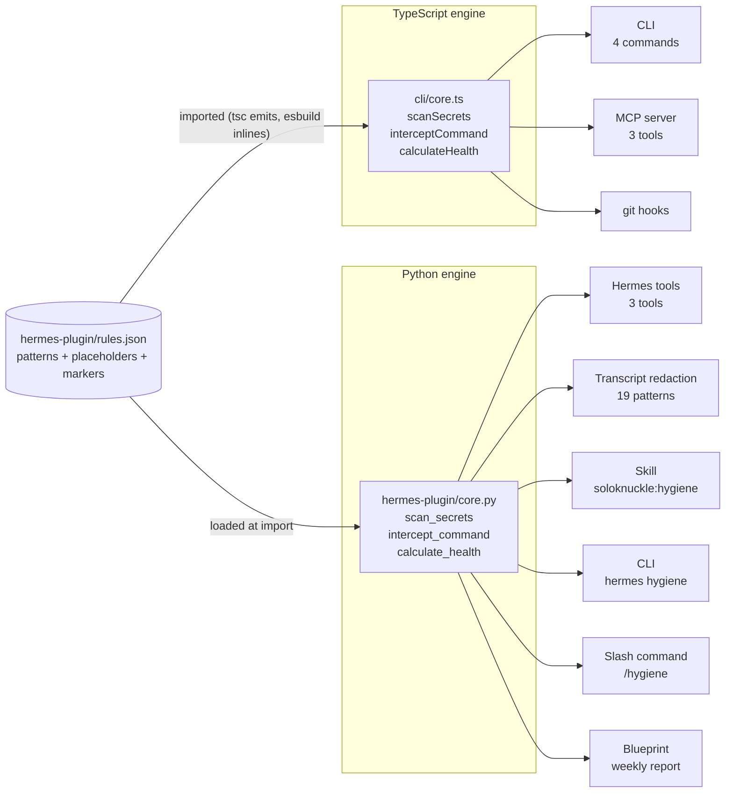
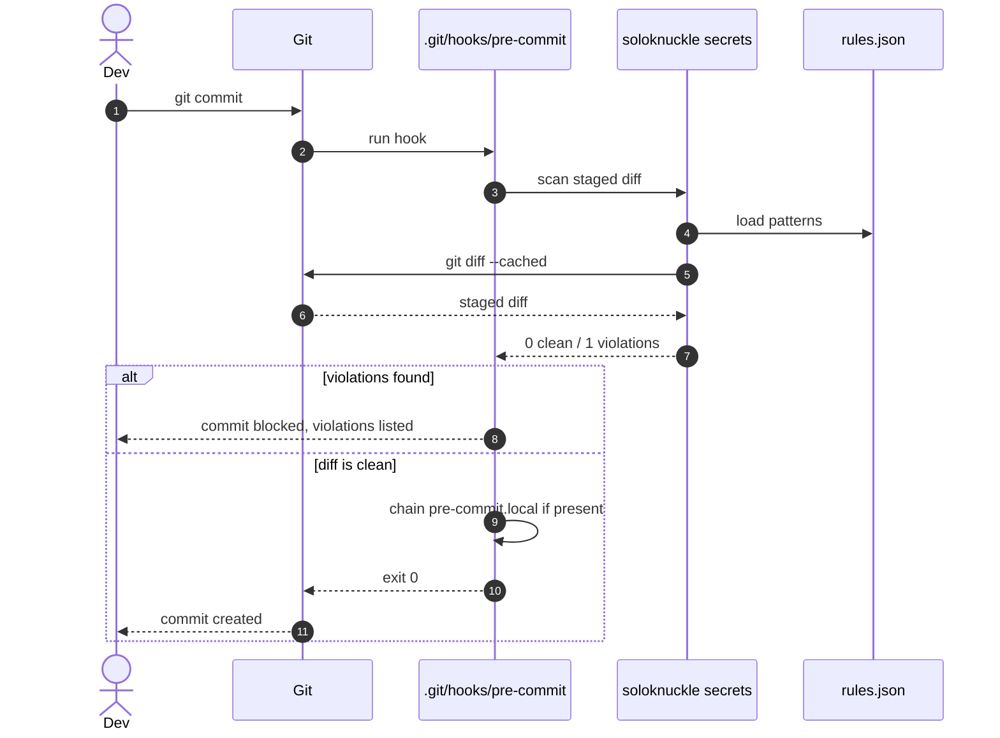
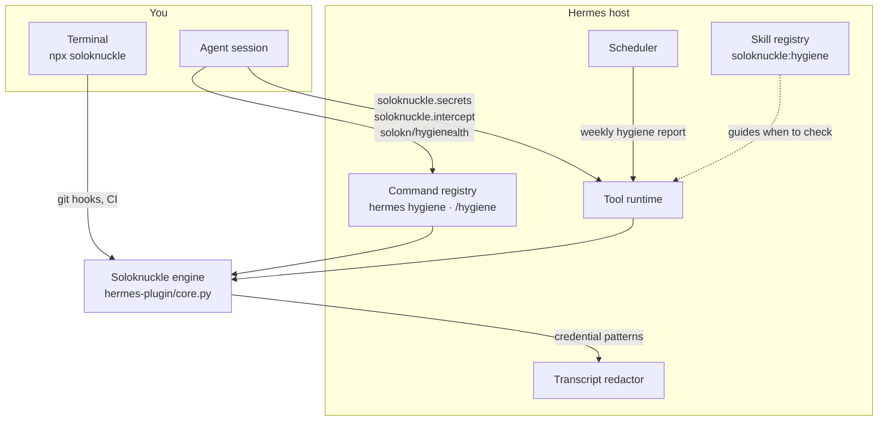

# Soloknuckle

**Deterministic production hygiene for solo developers** — secret scanning, a command firewall, and a project health gate that run the same way everywhere: in your terminal, in git hooks, in MCP clients, and inside Hermes Agent.

It doesn’t rely on a prompt remembering to be careful. It enforces checks as tools and gates, with one rule set and the same verdict on every surface.

- **Secrets** — catches credentials entering a diff before they become history
- **Firewall** — flags or blocks dangerous shell commands before they run
- **Health** — scores whether a project is actually ready to push/ship

Local-first, deterministic, and quiet by design: no telemetry, no analytics, no network calls, no background state.

## Why Soloknuckle

Most "be careful" guidance lives in prompts and habits. Soloknuckle turns the critical parts into **executable checks**:

- **Deterministic, not probabilistic:** the same input produces the same result, every time.
- **One engine, many surfaces:** the CLI, git hooks, MCP server, and Hermes plugin all follow the same rules (`hermes-plugin/rules.json`) with cross-engine parity tests.
- **Useful at the moment of risk:** scans staged changes, evaluates commands before execution, and gates pushes/CI with explicit exit codes.
- **Safe to adopt:** `init` never overwrites your existing hooks (it chains them), the plugin registers no hooks/middleware, and nothing rewrites model input or runs unless asked.
- **Transparent limits:** pattern-based diff scanning and syntax-based command checks are fast and dependable, and their boundaries are documented.

## Install

```bash
npx soloknuckle init        # try it without installing
npm install -g soloknuckle  # install once
```

Or the shell installer (needs Node 20+):

```bash
curl -fsSL https://raw.githubusercontent.com/z99wE/soloknucklefXrhermes/main/install.sh | bash
```

## Quick start

```bash
cd your-project
soloknuckle init      # scaffold AGENTS.md and safe git hooks
soloknuckle check     # score the project
git commit            # hooks scan the staged diff and commit message
```

`init` installs `pre-commit` (secret scan), `commit-msg` (Conventional Commits), and `pre-push` (blocking health check), and **never overwrites a hook you already have**: it preserves existing hooks as `<hook>.local` and chains them. Running `init` twice is a no-op.

## The three checks

### 1) Secrets — stop credentials before they land

Scans added lines in a diff (staged diff by default, or text you pass in) for known credential patterns before they become permanent.

```bash
soloknuckle secrets
```

```text
2 violation(s) found:
  -> Line 12: Stripe live key detected.
  -> Line 40: Private key detected.
```

**Covers common high-risk credentials:** Stripe, OpenAI/Anthropic-style keys, AWS, GitHub/GitLab, Slack, SendGrid, GCP, npm, Hugging Face, Shopify, database URIs with inline passwords, private keys, and more. Patterns live in [`hermes-plugin/rules.json`](hermes-plugin/rules.json).

**Explicit, reviewable escapes (greppable):**
- a match that is itself a placeholder token (`xxxx`, `your_key_here`, `mock`, …) is ignored
- any line containing `soloknuckle:allow` is ignored (intended for fixtures/docs — explain it in review)

> Scope: diff-based, pattern-based scanning of added lines. It is fast and deterministic, not a guarantee of catching every possible secret form.

### 2) Firewall — evaluate commands before you run them

Checks a shell command and returns a clear verdict: **blocked** (exit 1) for clearly destructive forms, **caution** (exit 0, with a safer suggestion) for risky ones, **allowed** (exit 0) otherwise.

```bash
soloknuckle intercept rm -rf /
# Blocked: Recursive delete of a filesystem root or home directory

soloknuckle intercept rm -rf ./build
# Caution: Recursive force delete
#   Suggestion: Use 'rm -i' or 'trash-put' instead

soloknuckle intercept ls -la
# Allowed
```

**Blocked examples:** root/home recursive deletion (incl. `sudo`/`doas`, `--no-preserve-root`, `/*`, `~`, `$HOME`), remote scripts piped into a shell or via process substitution, fork bombs, raw disk writes, filesystem formats, SQL `DROP`.  
**Caution examples:** `rm -rf`, `git push --force`, `chmod 777`, `git reset --hard`, `git commit --amend`.

> Scope: syntax/shape-based checks for known dangerous forms (not intent-proof against all indirection/obfuscation).

### 3) Health — a real gate, not a vague signal

Runs four deterministic checks and returns a score, grade, and actionable issues. Use `--min-score` to gate commits, pushes, or CI.

```bash
soloknuckle check --min-score 80
```

```text
  Score: 75/100  B

  Issues:
    -> Tests: failing
    -> Secrets: 2 violation(s)
```

| Check | Passes when |
|---|---|
| Dependencies | a `package.json` exists in the checked project |
| Lint | `npm run lint` exits 0 |
| Tests | `npm test` exits 0 |
| Secrets | the current diff is clean |

`npm` checks run only when the project has its own `package.json` (to avoid linting a parent repo). A non-npm project reports what’s missing rather than guessing. Grades: **A ≥ 90, B ≥ 70, C ≥ 40, F below 40**.

> Scope: a practical npm-project hygiene gate (presence/exit-status based), not a universal code-quality or security audit.

## Commands

| Command | What it does | Exit codes |
|---|---|---|
| `soloknuckle init` | Scaffold `AGENTS.md` and git hooks (`pre-commit`, `commit-msg`, `pre-push`) | 0 |
| `soloknuckle check [--min-score N]` | Health score (default gate: 70) | 0 pass, 1 below gate, 2 bad flag |
| `soloknuckle secrets [diff]` | Scan a diff for known credential patterns | 0 clean, 1 violations |
| `soloknuckle intercept <cmd...>` | Evaluate a shell command | 0 allowed/caution, 1 blocked |

## Architecture

One rule file, two implementations, every surface on top. The TypeScript engine serves the CLI, git hooks, and MCP server; the Python engine serves the Hermes plugin (self-contained, no `npx` dependency at tool-call time). Both read [`hermes-plugin/rules.json`](hermes-plugin/rules.json), and `test/parity.test.ts` fails the build if they ever disagree.



### What happens on `git commit`



## Hermes Agent integration

Soloknuckle is a native Hermes plugin — and fully optional on both sides: remove it and Hermes keeps working; skip Hermes and the CLI keeps working. It exposes **real, invocable surfaces** (not just guidance): 3 tools plus redaction, a skill, CLI/slash commands, and a weekly-report blueprint. Every surface is declared in [`hermes-plugin/plugin.yaml`](hermes-plugin/plugin.yaml) and visible in `hermes plugins capabilities`.

Crucially, it’s designed to be trustworthy inside an agent: **no hooks, no middleware, no prompt/context rewriting**. `provides_hooks: []` and `provides_middleware: []` are the machine-checkable form of that promise; tools run only when invoked.



| Surface | Type | What it gives you |
|---|---|---|
| `soloknuckle.secrets` | tool | Scan a diff for known credential patterns |
| `soloknuckle.intercept` | tool | Evaluate a command before it runs |
| `soloknuckle.health` | tool | Score the current project |
| Redaction patterns | additive | Helps keep matching credentials out of transcripts |
| `soloknuckle:hygiene` | skill | Teaches the agent when to run checks |
| `hermes hygiene` | CLI | `check`, `secrets`, `intercept <cmd>` |
| `/hygiene` | slash command | Same checks, mid-session |
| Weekly hygiene report | blueprint | A scheduled check nobody has to remember |

See [HERMES-INTEGRATION.md](HERMES-INTEGRATION.md) for the full surface map, safety rationale, and what is deliberately left out.

### Setup

```bash
hermes plugins install soloknuckle    # or validate a local checkout
hermes plugins validate ./hermes-plugin
hermes plugins enable soloknuckle
hermes hygiene --help
```

### MCP

Any MCP client can use the same three tools:

```json
{
  "mcpServers": {
    "soloknuckle": { "command": "npx", "args": ["-y", "soloknuckle-mcp"] }
  }
}
```

See [MCP-INTEGRATION.md](MCP-INTEGRATION.md).

## Extending the rules

Every pattern is data, not code:

```json
{
  "label": "Stripe live key",
  "pattern": "sk_live_[0-9a-zA-Z]{24}",
  "redact": true
}
```

Edit `hermes-plugin/rules.json`, run `npm test`, and the change reaches the CLI, MCP server, hooks, redactor, and Hermes surfaces together. A shared parity corpus (`test/parity.test.ts` + `hermes-plugin/tests/`) keeps both engines in agreement.

## Reliability and safety boundaries

- **No exfiltration, no hidden behavior:** no telemetry, no analytics, no network calls, no background watchers, no daemon, no state files written by the engine.
- **No surprise writes:** `init` scaffolds `AGENTS.md` and installs/chains hooks; it preserves existing hooks. Uninstall scripts remove only Soloknuckle’s own directories.
- **Deterministic checks with explicit scope:** secret scanning is diff/regex-based; the firewall is syntax-based; health is an npm-project gate. Results are explainable and reproducible.
- **Credential handling:** violation messages name the pattern/line, not the secret value. Redaction is additive.
- **Hermes-safe by construction:** declared surfaces match registrations; no hooks, no middleware, no core overrides, no self-updating code.

Details: [SECURITY.md](SECURITY.md), [HERMES-INTEGRATION.md](HERMES-INTEGRATION.md), [DISCLAIMER.md](DISCLAIMER.md).

## What this tool will never do

- Upload your code, diffs, or command text anywhere.
- Run in the background, watch files, or phone home.
- Modify your shell config or overwrite existing hooks without preserving them.
- Delete anything outside its own directories (`scripts/uninstall.sh` removes only Soloknuckle artifacts).
- Ask for an API key. There is no service to authenticate to.

## Development

```bash
npm install
npm run typecheck     # tsc --noEmit
npm run lint          # eslint
npm test              # vitest (includes TS <-> Python parity)
npm run test:coverage # coverage thresholds enforced
npm run test:smoke    # dist CLI smoke/integration check
npm run build         # tsc build
npm run build:bin     # portable release bundle
python3 -m pytest hermes-plugin/tests -q
hermes plugins validate ./hermes-plugin
```

The parity and plugin tests need a Python interpreter; set `SOLOKNUCKLE_PYTHON` if it is not on your `PATH`. See [CONTRIBUTING.md](CONTRIBUTING.md).

## Uninstall

```bash
bash scripts/uninstall.sh        # macOS / Linux
.\scripts\uninstall.ps1          # Windows
npm uninstall -g soloknuckle
```

Removes the plugin directory and `~/.soloknuckle`, and nothing else — not `~/.hermes/state.db`, not memories, not logs.

## License

ISC. See [LICENSE](LICENSE), [SECURITY.md](SECURITY.md), and [DISCLAIMER.md](DISCLAIMER.md).
